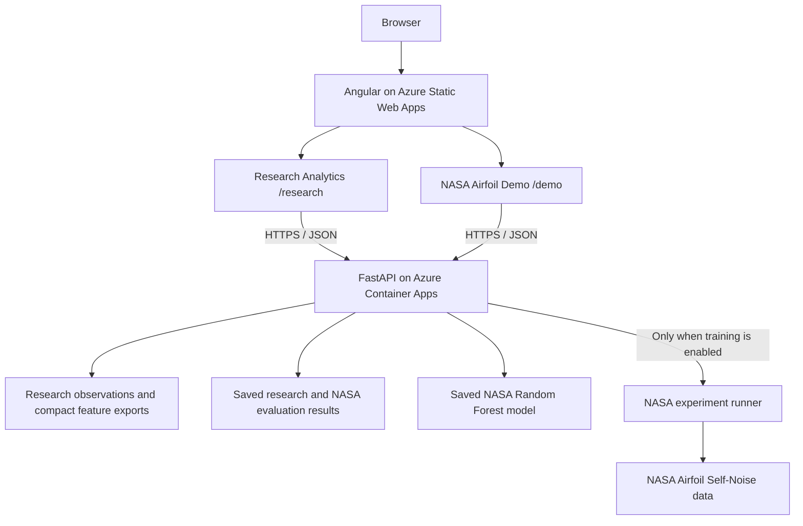

# AeroLab AI — Interactive Aerospace Research Analytics & Machine Learning

Explore experimental aerodynamic response, compare research evaluation results, and try a separate airfoil-noise prediction demo in one full-stack application.

[Research Dashboard](https://happy-ocean-045bd8f1e.6.azurestaticapps.net/research) · [NASA Airfoil Demo](https://happy-ocean-045bd8f1e.6.azurestaticapps.net/demo) · [API Documentation](https://aerolab-api.lemonsmoke-03aa9e66.westus2.azurecontainerapps.io/docs)

## Overview

AeroLab AI combines a **CSCI 5415 research analytics dashboard** with a separate **NASA Airfoil Self-Noise machine learning demo**. Angular provides the interactive interface; FastAPI serves experimental records, saved evaluation results, and predictions from a saved model.

| Experience | Dataset and purpose | Scientific target |
| --- | --- | --- |
| **Research Analytics** — `/research` | Experimental DBD plasma flow-control sequences, surface microphone features, and aerodynamic response | Lift coefficient **C_L**, change from a run's baseline **ΔC_L**, and baseline-relative response **R** |
| **NASA Airfoil Demo** — `/demo` | NASA Airfoil Self-Noise dataset: **1,503 observations**, five input variables | Scaled sound pressure level in **decibels (dB)** |

The research dashboard explores aerodynamic lift and acoustic-feature relationships. The NASA model predicts sound pressure level; it does not predict lift. The homepage redirects to `/research`.

## Research dataset

| Dataset property | Verified contents |
| --- | --- |
| Experimental runs | **156** |
| Observations | **3,276** |
| Observations per run | **21**, including baseline step 0 |
| Microphone channels | **8** — Mic3–Mic10 |
| Originally engineered features | **244**, including individual-channel, microphone-pair, and aggregate features |
| Experimental sequences | **30 ascending**, **76 descending**, **50 randomized** |

Forcing frequencies span 1–20 Hz; 0 Hz represents the uncontrolled baseline. Experimental steps preserve acquisition order, including descending and randomized sequences.

Dataset metadata is recorded in [dataset_info.json](data/research/dataset_info.json). The application serves compact research exports rather than raw microphone recordings or the full engineered-feature matrix.

## Research dashboard

| Visualization | What you can explore |
| --- | --- |
| **Experiment Overview** | Dataset composition, experimental context, and the research question |
| **Aerodynamic Lift Repeatability** | Mean ΔC_L with shaded **±1 between-run sample SD**; compare sequence patterns using step or forcing-frequency views |
| **Machine Learning Results** | Reported lift-prediction metrics and evaluation context presented by the dashboard |
| **Model Performance vs. Feature Count** | Ridge Regression and Random Forest across feature subsets, targets C_L/R, and microphone-only or action-plus-microphone representations |
| **Experimental Run Explorer** | Actual forcing-frequency/lift-response observations in a scatter plot, filtered by experimental run |
| **Combined Experimental Timeline** | Measured ΔC_L on the left Y-axis and applied forcing frequency in Hz on the right, ordered by experimental step |
| **Microphone Intelligence — Acoustic Feature Explorer** | Existing engineered RMS values by step, with run selection, Mic3–Mic10 channel toggles, exact-value tooltips, and an accessible data table |
| **Microphone Feature Importance** | Qualitative findings already attributed to the submitted report, with explanatory text rather than numerical importance scores |

The feature-count comparison displays saved five-fold cross-validation summaries grouped by experimental run. Its error bars represent **±1 sample SD across held-out folds**, not confidence intervals. “All” denotes the training-fold correlation-pruned feature representation, not all 244 original features. The dashboard displays these evaluation results without retraining research models.

### Scientific interpretation

- **Measured response and model performance are different quantities.** Run charts show experimental observations; R², MAE, and RMSE describe predictive evaluation results.
- **RMS values are engineered acoustic features.** They are not raw waveforms, full frequency spectra, selection frequencies, or model-importance scores. The explorer preserves existing values without normalization or averaging.
- **Channel IDs are identifiers.** The application does not establish physical microphone coordinates or calibrated cross-channel physical units. Amplitude units and calibration remain undocumented in the available exports.
- **Importance describes predictive association, not causation.** A large feature value does not establish that a microphone is more important to a model.
- **This is an analytics application.** It does not provide live experimental control or acquire live microphone signals.

The acoustic explorer currently offers RMS only. Spectral-band families are omitted because their extraction definitions have not been verified locally.

## NASA Airfoil Demo

The separate NASA demo uses a saved **Random Forest** model with frequency, angle of attack, chord length, free-stream velocity, and suction-side displacement thickness as inputs.

- **Prediction:** estimate scaled sound pressure level in dB.
- **Frequency sweep:** compare model predictions over a selected frequency range while holding other inputs fixed.
- **Model comparison:** inspect saved baseline and tuned evaluation results.
- **Hyperparameter Lab:** run configurable local experiments when training is enabled, evaluated on a validation split separate from the final test portion.

The NASA experiment runner supports Linear Regression, Decision Tree, Random Forest, Gradient Boosting, and Support Vector Regression. Research feature-count comparisons use Ridge and Random Forest; these are separate workflows and datasets.

| Metric | Meaning |
| --- | --- |
| **R²** | Coefficient of determination; may be negative on held-out data |
| **MAE** | Mean absolute prediction error, in the target's units |
| **RMSE** | Root mean squared prediction error, in the target's units; gives greater weight to large errors |

The public `/experiments/train` operation is disabled in production for resource protection. The Docker image defaults to `ENABLE_TRAINING=false`, returning HTTP 403 for training requests. Local Python execution enables training when the variable is unset; set it explicitly as shown below to choose local behavior. Prediction, sweep, comparison, and research endpoints remain available independently of this flag.

## Technology and architecture

| Layer | Technologies |
| --- | --- |
| Frontend | Angular 20, TypeScript, SCSS, RxJS |
| Visualization | Chart.js and Plotly.js |
| API | Python 3.11, FastAPI, Pydantic, Uvicorn |
| Data and machine learning | scikit-learn, pandas, NumPy, joblib |
| Container packaging and distribution | Docker; container registries such as Docker Hub |
| Hosting | Azure Static Web Apps for the frontend; Azure Container Apps for the backend |
| Frontend delivery | GitHub Actions |



### Two separate deployment paths

**Frontend:** the existing [GitHub Actions workflow](.github/workflows/azure-static-web-apps-happy-ocean-045bd8f1e.yml) deploys production on pushes to `main`. Pull requests targeting `main` trigger preview deployment and cleanup. It builds `frontend/` and publishes `dist/frontend/browser` to Azure Static Web Apps. The included [routing configuration](frontend/public/staticwebapp.config.json) supports direct navigation and refresh on `/research` and `/demo`.

**Backend:** the [Dockerfile](Dockerfile) packages FastAPI, the saved NASA model, NASA evaluation results, and required research exports. Backend release is separate: build an image, publish it to a container registry such as Docker Hub, and update Azure Container Apps to use that image. The repository does not prescribe a registry account or deployed image tag. The frontend workflow does **not** deploy the backend; releases must keep the frontend and API compatible.

## API endpoints

See the [interactive API documentation](https://aerolab-api.lemonsmoke-03aa9e66.westus2.azurecontainerapps.io/docs) for request schemas and validation.

| Method | Endpoint | Purpose |
| --- | --- | --- |
| GET | `/` | API status and saved NASA model information |
| GET | `/research/runs` | List experimental runs and sequence types |
| GET | `/research/action-lift` | Observation-level forcing frequency and ΔC_L; optional `DatasetName`, `limit` from 1–200, default 200 |
| GET | `/research/repeatability` | Per-step repeatability means, sample SD, and run counts by sequence group |
| GET | `/research/supervised` | Saved C_L/R evaluation summaries for Ridge and Random Forest |
| GET | `/research/acoustic-features` | One complete selected run; required `DatasetName`, permitted `feature=rms` (default) |
| POST | `/predict` | Predict NASA sound pressure level from five validated inputs |
| POST | `/predict/sweep` | Predict a frequency sweep with 2–100 points |
| GET | `/models/comparison` | Saved NASA baseline and tuned model results |
| POST | `/experiments/train` | Train/evaluate a NASA experiment only when enabled; disabled in production |

For example, `/research/acoustic-features?DatasetName=downward_01&feature=rms` returns 21 step-ordered records containing observation/run identifiers and a `values` object keyed by `Mic3` through `Mic10`. These are existing RMS feature values, not newly computed signals.

## Running locally

Prerequisites: **Python 3.11**, Node.js/npm compatible with Angular 20, and optionally Docker Desktop with its Linux engine. Run the following commands in **Windows PowerShell**.

### 1. Start the backend

From the repository root:

```powershell
Set-Location C:\Users\19159\Desktop\csci5415\aerolab
python -m venv .venv
.\.venv\Scripts\python.exe -m pip install -r requirements.txt
$env:ENABLE_TRAINING = "false"
.\.venv\Scripts\python.exe -m uvicorn backend.main:app --reload --host 127.0.0.1 --port 8000
```

Local API documentation: [http://127.0.0.1:8000/docs](http://127.0.0.1:8000/docs). To enable the local NASA Hyperparameter Lab, set `$env:ENABLE_TRAINING = "true"` before starting the backend. Viewing the research dashboard does not require training.

### 2. Start the frontend

In a second PowerShell terminal:

```powershell
Set-Location C:\Users\19159\Desktop\csci5415\aerolab\frontend
npm.cmd ci
npm.cmd start
```

Open [Research Analytics](http://localhost:4200/research) or the [NASA demo](http://localhost:4200/demo).

Development uses `http://127.0.0.1:8000`; production defaults to the existing HTTPS Container Apps API. The public `aerolab-api-base-url` meta tag in `frontend/src/index.html` can override the API base URL. `FRONTEND_ORIGINS` sets permitted deployed frontend origins as a comma-separated list, overriding the default production origin; localhost origins remain allowed. Never put secrets in frontend configuration.

### 3. Optional local Docker backend

From the repository root, with the Python backend stopped if it occupies port 8000:

```powershell
docker build -t aerolab-backend .
docker run --rm -p 8000:8000 aerolab-backend
```

This uses the image's training-disabled default. It does not publish an image or deploy to Azure.

### Checks

From the repository root:

```powershell
.\.venv\Scripts\python.exe -m unittest discover -s backend/research -p "test_*.py" -v
.\.venv\Scripts\python.exe -m unittest backend.test_production -v
.\.venv\Scripts\python.exe -m pip check
Push-Location frontend
npm.cmd test -- --watch=false --browsers=ChromeHeadless
npm.cmd run build -- --configuration development
npm.cmd run build -- --configuration production
Pop-Location
```

Browser tests require Chrome. Builds can emit the existing Plotly CommonJS optimization warning.

## Research data packaging

| File in `data/research/` | Application use |
| --- | --- |
| `observations.csv` | Experimental run exploration and measured response |
| `repeatability_by_step.csv` | Repeatability plot summaries |
| `supervised_summary.csv` | Saved feature-count/model-performance comparisons |
| `dataset_info.json` | Dataset metadata |
| `acoustic_rms.csv` | Compact RMS export for eight microphone channels |

The compact RMS export preserves source decimal values and joins observations using verified `ObservationID` and `SignalIndex` identifiers. Its [export script](scripts/export_acoustic_features.py) checks alignment and complete steps 0–20 without extracting new features or fitting models.

The full `features.csv` remains intentionally excluded from Git and Docker. Raw waveform archives, local credentials, environments, and generated caches are also excluded. A normal checkout contains the compact export needed by the explorer; regenerating it requires the local source feature matrix. The two source-matrix-dependent integrity tests skip when that unpublished file is absent.

---

Developed as a CSCI 5415 aerospace research and data mining project, combining scientific visualization, machine learning evaluation, API development, and cloud application delivery.
